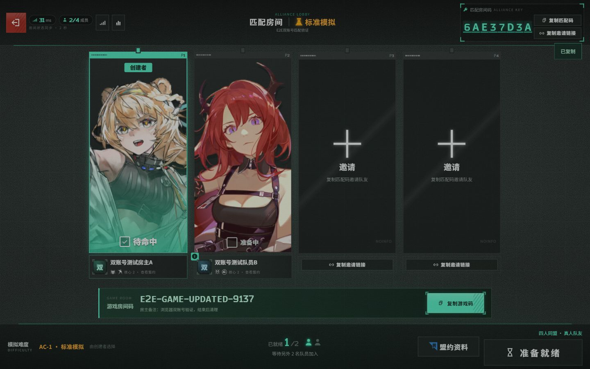

# 卫戍协议四人匹配房间

入口为明日方舟侧导航中的「联机组队 → 卫戍协议 · 四人组队」，路径 `/defense-team`。界面默认中文，保留英文消息；作战提示默认隐藏，可手动开启。

## 使用流程

1. 在个人资料选择 2–4 个核心盟约，可另选附加盟约；个人偏好保存在当前网站账号下。
2. 房主创建匹配房间，系统生成独立匹配码。游戏房间码可先留空，之后在等待室提供或修改。
3. 队友选择服务器和难度后快速匹配，或使用匹配码、邀请链接确认入队。
4. 入队后即可查看和复制房主提供的游戏房间码，无需等待四人全部准备；未入队用户与已离队用户不能读取后续游戏码。
5. 队员可准备、取消准备。房主需等四人到齐、其余队员全部准备并已提供游戏码后，才能标记站内出发。实际游戏仍使用游戏房间码进入。

## 匹配与等待室

- 默认读取个人资料，也可设置不覆盖个人资料的临时偏好。
- 核心盟约重合权重为附加盟约的两倍；比较加入后的全队两两组合，优先互补。未填写偏好按未知处理，不视为完全互补。
- 队伍盟约条件在同组内满足任一项，核心、附加两组之间同时满足；自己的房间始终显示。
- P1–P4 席位固定，退出不会挤动其他队员位置；加入或离队、房主修改难度会重置准备。
- 每个账号同时只能加入一个房间，最多四人；等待室每两秒同步，刷新后恢复所在房间。
- 等待室可查看队员的两排盟约偏好，他人资料只读。匹配房间两小时过期。
- 游戏房间码只允许房主更新，仅当前成员可见；更新不会改变匹配码及邀请链接。

## 数据与验证

部署前运行 `npm run db:migrate`。本功能包含 `0028`–`0034` 迁移，保留此前本地迭代的迁移顺序；无账号、会话、真实连接信息或本地登录捷径改动。

- `npm run test:defense-team`：参数、核心盟约数量与互补评分。
- `npm run test:defense-team:integration`：配置专用 `AUTH_INTEGRATION_DATABASE_URL` 后运行。数据库名须为 `riic_defense_*_test`，或 CI 专用 `arknights_auth_test`；无配置时跳过。
- 集成覆盖并发四人上限、固定席位、准备与开始权限、邀请码、延迟发码、码更新同步与隐私、账号资料隔离。
- 本地已用两个独立账号、真实密码会话完成浏览器验证：B 快速匹配进入 A 房间，入队前游戏码隐藏，入队后两次复制的剪贴板内容分别与原码、新码一致，刷新恢复及解散同步正常。所有测试账号和服务已清理。

## 界面与美术来源

布局、交互与部分美术资源参考、复用 [卫戍协议：盟约](https://wei.linxia.dev/) 的公开页面，包括背景、盟约图标、协议插画、装饰立绘及按钮图标。原作者及相关权利人保留相应权利；来源备注不代表已获再分发授权。完整范围和校验清单见 [第三方资源来源](../THIRD_PARTY_ASSETS.md)。

## 个人立绘

个人资料中可选择两张现有完整立绘，或恢复按座位分配的默认立绘。选择随账号保存，等待室轮询同步给队友；仅允许已收录的本地素材标识。新增迁移 0034_defense_portrait，需在启动前执行。
