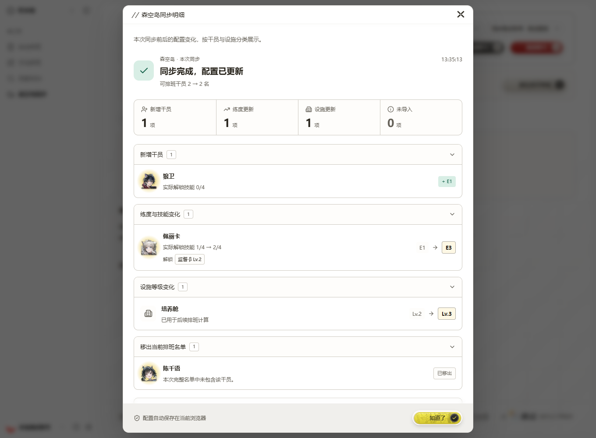

# 终末地森空岛同步明细

手动同步、扫码登录成功、切换角色以及恢复账号实际配置后，按应用前后的本地配置计算差异，并自动打开结果明细。可在森空岛页的「最近同步明细」重新查看；其他页面的同步提示也提供「查看明细」。被动恢复不自动弹窗，且不会用重复的无变化结果覆盖上一份有效明细。

- 展示新增、移出、精英阶段和实际技能节点变化，以及五个排班设施的等级变化；等级降低同样记录。
- 技能按实际节点比较，忽略节点数组的顺序或重复值。原有节点未知时，注明此前按精英化估算。
- 不完整名单只报告实际应用的更新；未返回的同账号原有干员继续保留。新账号名单不完整或不受支持时，说明本地配置未被覆盖。
- 设施数据无效或不完整时，说明保留了本地等级，不将其标成已核对。
- 管理员等无基建技能角色不再显示为未导入提醒，实际可排班规则不变。未知干员仍显示未支持原因。
- 切换账号或网站会话时清理旧明细，避免把上一账号的数据继续展示。明细只保留于当前页面会话，不另存凭据或完整森空岛响应。

界面复用 DialogFrame、OperatorPortrait、Action 和 Notice。同步页突出同步主按钮，最近结果使用状态条；明细按组折叠，突出前后等级并以标签显示解锁技能，支持手机、键盘和深色模式。

## 验证

`npm run test:endfield` 包含差异计算和原有同步工作区测试。`npm run test:endfield:sync-details:e2e` 启动临时本机账号夹具和预览服务，验证公开页面匿名访问返回 200；浏览器使用隔离的接口夹具验证登录后的同步流程、再次同步无变化、重新打开、分组折叠、键盘关闭及本地应用值，不使用真实玩家账号或凭据。

以下截图来自隔离测试夹具，不代表真实账号：

本机使用已安装的 Edge 可设置 `PLAYWRIGHT_CHANNEL=msedge`。测试结束关闭专用服务，不连接正在运行的浏览器，也不读取本地账号配置。

## 理智与通行证进度

状态总览及「理智恢复」「通行证进度」展开详情复用 SklandProgress，展示当前值、上限、百分比和可访问的原生进度条，每日任务保持同一显示方式。0 是有效数据；数据缺失不推断为 0。超过上限保留真实数字，条形填充最多 100%。其余恢复时间等原始详情保留。浏览器回归覆盖零值、部分/满进度、超上限和缺失数据。
